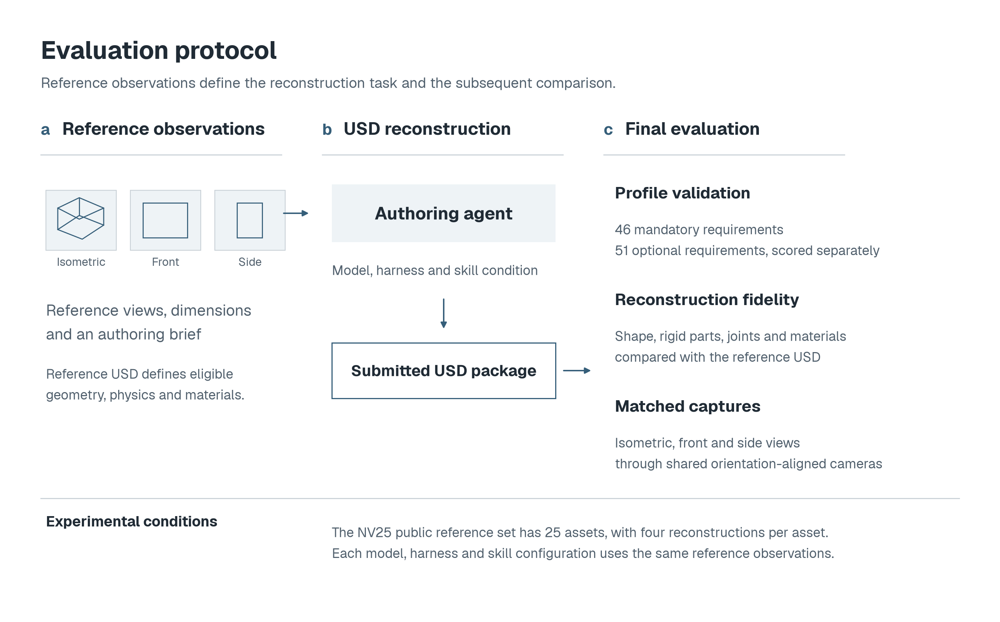
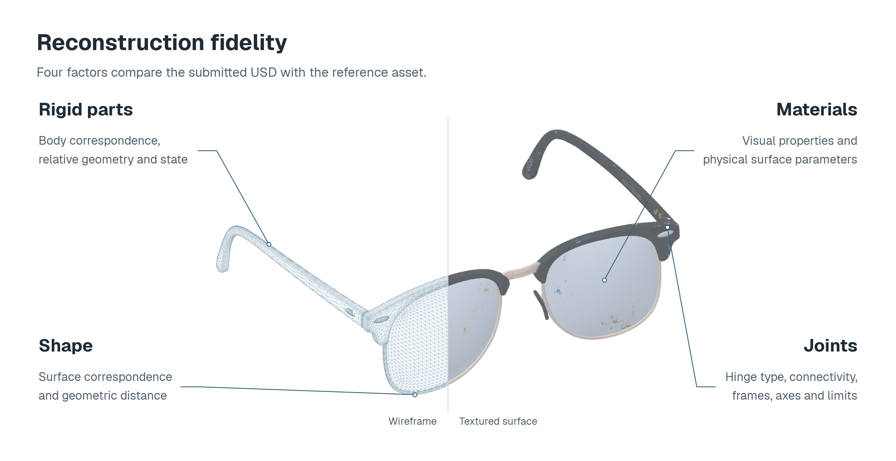

<div align="center">
  <h1>SimReadyBench</h1>
  <p><strong>A benchmark for simulation-ready asset reconstruction</strong></p>
  <p>
    <a href="https://chrisvoncsefalvay.com">Chris von Csefalvay</a>,
    Pranav Doma, Achyuthan Unni Krishnan and
    <a href="https://github.com/tfoldi">Tamas Foldi</a>
  </p>
  <p><a href="https://www.hcltech.com/">Robotics Intelligence CoE, HCLTech, Santa Clara, CA</a></p>
  <p>
    <a href="https://hcltech-robotics.github.io/simreadybench/"></a>
    <a href="https://hcltech-robotics.github.io/simreadybench/#paper"></a>
    <a href="https://github.com/hcltech-robotics/simreadybench"></a>
    <a href="https://huggingface.co/datasets/hcltech-robotics/simreadybench"></a>
    <a href="https://github.com/hcltech-robotics/simreadybench/blob/main/docs/evaluation.md"></a>
    <a href="https://github.com/hcltech-robotics/simreadybench/blob/main/LICENSE"></a>
  </p>
</div>

SimReadyBench turns reference OpenUSD assets into Harbor reconstruction tasks and evaluates the generated assets. It measures formal fidelity, visual fidelity and kinematic fidelity, with models, agent harnesses and authoring skills as independent experimental factors. The same environment supplies validator feedback and terminal rewards for reinforcement learning with an externally trained policy.


## Install

Use Python 3.12 in a Linux or WSL shell:

```sh
git clone https://github.com/hcltech-robotics/simreadybench.git
cd simreadybench
python3.12 -m venv .venv
. .venv/bin/activate
python -m pip install '.[daytona,publish]'
```

## Run the first benchmark

Set `DAYTONA_API_KEY` and import the [published runtime](https://github.com/hcltech-robotics/simreadybench/pkgs/container/simreadybench-runtime) into your organisation:

```sh
simready-bench setup daytona --output ../simreadybench-runtime.json
```

Set `OPENAI_API_KEY` for the example model, then run with the saved runtime configuration:

```sh
simready-bench benchmark nvidia-25 --model gpt-6.1-sol --harness pi --deploy daytona --runtime-images ../simreadybench-runtime.json --repetitions 4 --authoring-turns 64 --workers 4 --supervise --output-dir ../simreadybench-results
```

On a Linux/Docker host with the [local runtime images](docs/deployment.md#local), use their `local-runtime-images.json`:

```sh
python -m pip install '.[validator]'
simready-bench benchmark nvidia-25 --model gpt-6.1-sol --harness pi --deploy local --runtime-images /tmp/srb-snapshot/local-runtime-images.json --repetitions 4 --authoring-turns 64 --output-dir ../simreadybench-nv25-local
```

The standard NV25 command runs four reconstructions per asset, giving 100 attempts with up to 64 authoring turns each. Open `report.html` in the output directory to inspect scores and aligned captures. `scores.csv` contains the score table and `results.json` contains the structured measurements and trace links. Completed reconstructions enter the report during the run.

`--workers` selects a positive number of Daytona workers within your organisation's CPU, memory and disk allocation. Transient asset downloads retry automatically, failed workers are replaced without waiting for the others and `--supervise` restarts an interrupted coordinator using the saved run. Completed conditions and admitted attempts retain their original identities and authoring limits. To publish completed readouts during evaluation, set `HF_TOKEN` and add `--hf-repo YOUR_ACCOUNT/simreadybench-results --hf-run RUN_ID`.

For built-in providers, the default accounting allowance covers every permitted request at the provider's full native capacity. `allowance.json` records its derivation. Add `--max-spend-usd AMOUNT` to impose a separate monetary ceiling, or supply an operator policy with an existing allowance.



## Compare models, harnesses and skills on your assets

Keep each reference USD with its textures, materials and composed layers. Select one asset by its USD path or list several entry points in `references.json`:

```json
[
  "hinged_case/hinged_case.usd",
  "drawer/drawer.usd",
  "pallet/pallet.usda"
]
```

`--assets-root ./references` locates these packages. Run each model, harness and skill condition with its own output directory:

```sh
for model in gpt-6.1-sol gpt-6-astra; do
  for harness in pi opencode; do
    simready-bench benchmark ./references.json --assets-root ./references --model "$model" --harness "$harness" --deploy daytona --runtime-images ../simreadybench-runtime.json --repetitions 4 --authoring-turns 64 --supervise --output-dir "../experiments/$model-$harness-none"
    simready-bench benchmark ./references.json --assets-root ./references --model "$model" --harness "$harness" --skills ./skills/usd-authoring --deploy daytona --runtime-images ../simreadybench-runtime.json --repetitions 4 --authoring-turns 64 --supervise --output-dir "../experiments/$model-$harness-usd-authoring"
  done
done
```

This compares two models, two harnesses and the presence of the selected skill set, with four reconstructions per asset. The [configuration guide](docs/configuration.md#references) describes custom reference images, dimensions and model connections.

## Connect a model provider

The model connection must accept reference images and tool calls. Provider credentials stay with the benchmark controller.

| Provider | Connection | Credential | Example model |
| --- | --- | --- | --- |
| OpenAI | Native Responses API with `--provider openai` | `OPENAI_API_KEY` | `gpt-6.1-sol` |
| Hugging Face | Routed Chat Completions with `--provider huggingface` | `HF_TOKEN` | `google/gemma-4-31B-it:novita` |
| Anthropic | OpenAI-compatible LiteLLM gateway selected by an operator policy | `ANTHROPIC_API_KEY` in the gateway and `LITELLM_MASTER_KEY` in SimReadyBench | `claude-sonnet-5-5` |

The [provider configuration](docs/configuration.md#model-connections) includes the Hugging Face route syntax, Anthropic gateway setup and custom endpoint policies.

## Use your assets for reinforcement learning

Serve the policy being trained through an OpenAI-compatible endpoint and select it with an operator policy. SimReadyBench runs each reconstruction as a Harbor episode, supplies the reference observations and authoring tools and evaluates the submitted USD. During the episode, `validate_candidate` returns SimReady Robotics-Prop feedback. At termination, Harbor receives the formal fidelity reward, while the final readout contains the three independent composites and the agent trace.

Your trainer collects these episodes and updates the served policy between rollouts. The [reinforcement learning guide](docs/reinforcement-learning.md) shows a single-asset episode loop and the reward/readout interface.

## Reference sets and evaluation

NV25 and NV100 are distinct public reference sets, separate from the withheld internal benchmark reference set. The packaged [`nvidia-25` manifest](src/simready_bench/resources/benchmarks/nvidia-25.json) defines NV25 and its 25 NVIDIA SimReady assets.



| Composite score | Measurement |
| --- | --- |
| Formal fidelity | NVIDIA SimReady-Foundation Robotics-Prop 4.0.0 mandatory requirements and strict profile pass |
| Visual fidelity | Geometric mean of reference-scale shape correspondence and appearance material correspondence |
| Kinematic fidelity | Recovery of the reference joints and their allowed motion, with penalties for missing or additional joints |

Formal fidelity is `95 x passed/46`, with five additional points when all 46 mandatory requirements pass. The 51 optional requirements receive a separate score of `100 x passed/51`. Reports retain the individual measurements with their earned credit, eligible denominators and coverage.

Fidelity evaluation normalises units and the up-axis, then aligns the reconstruction with one whole-object yaw and translation. Object scale and relative part transforms are preserved, with no scale fitting or independent part fitting. Reference and reconstruction captures share the same aligned cameras. The [scoring guide](docs/evaluation.md) gives the diagrams, formulas and full measurement definitions.

The [leaderboard](https://huggingface.co/datasets/hcltech-robotics/simreadybench) reports complete NV25 sets with 95% confidence intervals, token and elapsed-time efficiency and strict pass rates. Tables and plots update automatically when a complete set is published. The dataset viewer shows paired reference and candidate images, with subsets for models, harnesses, skills, protocols and assets. The [statistics guide](docs/leaderboard.md) defines the intervals and efficiency denominators.

## Authors and citation

Chris von Csefalvay, Pranav Doma, Achyuthan Unni Krishnan and Tamas Foldi, HCLTech. Cite the software using [CITATION.cff](CITATION.cff). The code is licensed under [MIT](LICENSE), and the reference assets use the [NVIDIA SimReady Assets licence](https://huggingface.co/datasets/nvidia/simready-assets).
