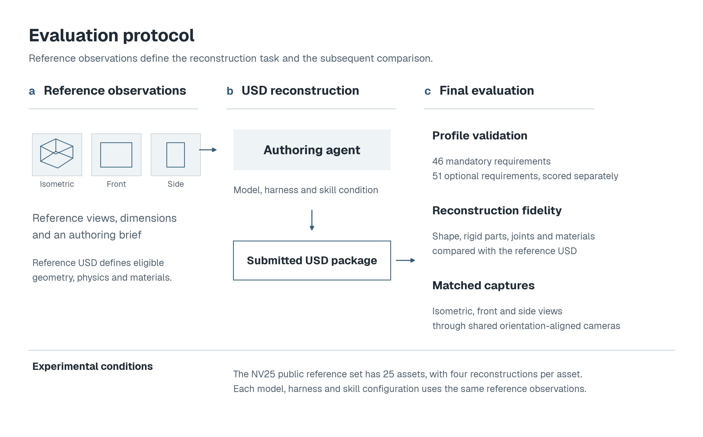
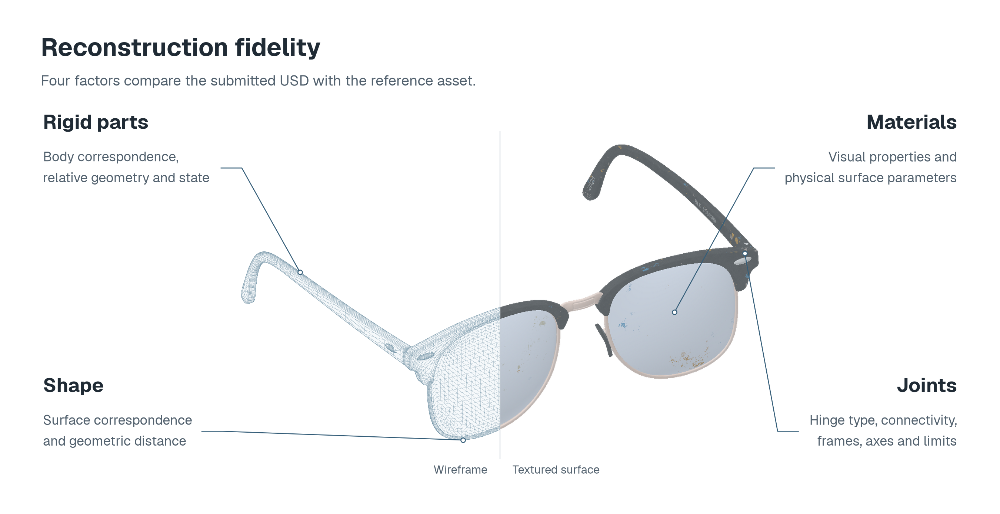

<div align="center">
  <h1>SimReadyBench</h1>
  <p><strong>A benchmark for simulation-ready asset reconstruction</strong></p>
  <p>
    <a href="https://chrisvoncsefalvay.com">Chris von Csefalvay</a>,
    Pranav Doma, Achyuthan Unni Krishnan and
    <a href="https://github.com/tfoldi">Tamas Foldi</a>
  </p>
  <p><a href="https://www.hcltech.com/">Robotics Intelligence CoE, HCLTech, Santa Clara, CA</a></p>
  <p>
    <a href="https://hcltech-robotics.github.io/simreadybench/"></a>
    <a href="https://github.com/hcltech-robotics/simreadybench"></a>
    <a href="https://huggingface.co/datasets/hcltech-robotics/simreadybench"></a>
    <a href="https://hub.harborframework.com/datasets/hcltech-robotics/simreadybench"></a>
    <a href="https://github.com/hcltech-robotics/simreadybench/blob/main/docs/evaluation.md"></a>
    <a href="https://github.com/hcltech-robotics/simreadybench/blob/main/LICENSE"></a>
  </p>
</div>

SimReadyBench turns reference OpenUSD assets into Harbor reconstruction tasks and evaluates the generated assets. It measures formal fidelity, visual fidelity and kinematic fidelity, with models, agent harnesses and authoring skills as independent experimental factors. The same environment supplies validator feedback and terminal rewards for reinforcement learning with an externally trained policy.


## NV100 tasks and data

The native evaluator is 2.2.0. Its [frozen release record](docs/evaluator-2.2.0.md) binds this source to the published NV100 tasks and accepted wheel.

NV100 contains 100 OpenUSD reconstruction tasks. Each task supplies one reference image, an authoring brief and nominal dimensions. The agent produces a USD package with its geometry, materials, rigid bodies and joints. Evaluation reports formal, visual and kinematic fidelity separately.

The [Harbor Hub dataset](https://hub.harborframework.com/datasets/hcltech-robotics/simreadybench) contains the runnable tasks. [Hugging Face](https://huggingface.co/datasets/hcltech-robotics/simreadybench) contains the source assets, instructions, 100 public observations, 400 verifier comparison images, masks, camera data and licences.

On a Linux Docker host, install Harbor with Python 3.12 and download the tasks:

```sh
python3.12 -m venv .venv
. .venv/bin/activate
python -m pip install harbor==0.24.0
harbor download hcltech-robotics/simreadybench@nv100-v1 --output-dir ./nv100
```

Check local setup with one task and a no-op agent:

```sh
harbor run --dataset hcltech-robotics/simreadybench@nv100-v1 \
  --agent nop --n-tasks 1 --n-concurrent 1 --max-retries 0
```

The no-op agent submits no asset, so its scores are zero. For a reconstruction experiment, select a Harbor agent and model, configure its provider credentials and add the provider endpoints to `agents[].extra_allowed_hosts`. The [Harbor documentation](https://harborframework.com/docs) describes agent configuration.

The verifier requests 16 GiB of memory. Allow additional memory for the host and other services. Rendering uses the CPU. Each submission has a top-level `asset.usd`, includes all dependencies, and is limited to 1 GiB and 10,000 files/directories. Up to five formal validator feedback calls are available. Blender is reserved for verifier rendering.

Each task manifest pins its asset revision and file checksums. The agent receives the public observation and instructions; reference USDs and the four comparison views are supplied separately to the verifier.

## Install the benchmark tools

Use Python 3.12 in a Linux or WSL shell:

```sh
git clone https://github.com/hcltech-robotics/simreadybench.git
cd simreadybench
python3.12 -m venv .venv
. .venv/bin/activate
python -m pip install '.[daytona,publish]'
```

## Run the first benchmark

Set `DAYTONA_API_KEY` and import the [published runtime](https://github.com/hcltech-robotics/simreadybench/pkgs/container/simreadybench-runtime) into your organisation:

```sh
simready-bench setup daytona --output ../simreadybench-runtime.json
```

Set `OPENAI_API_KEY` for the example model, then run with the saved runtime configuration:

```sh
simready-bench benchmark nvidia-25 --model gpt-6.1-sol --harness pi --deploy daytona --runtime-images ../simreadybench-runtime.json --repetitions 4 --authoring-turns 64 --workers 4 --supervise --output-dir ../simreadybench-results
```

On a Linux/Docker host with the [local runtime images](docs/deployment.md#local), use their `local-runtime-images.json`:

```sh
python -m pip install '.[validator]'
simready-bench benchmark nvidia-25 --model gpt-6.1-sol --harness pi --deploy local --runtime-images ./local-runtime-images.json --repetitions 4 --authoring-turns 64 --output-dir ../simreadybench-nv25-local
```

The standard NV25 command runs four reconstructions per asset, giving 100 attempts with up to 64 authoring turns each. Open `report.html` in the output directory to inspect scores and aligned captures. `scores.csv` contains the score table and `results.json` contains the structured measurements and trace links. Completed reconstructions enter the report during the run.

Concurrency, retries and recovery are described in the [deployment guide](docs/deployment.md#recovery).

## Monitor a Daytona run

Follow the `simready-benchmark` and `simready-model-relay` session logs in each Daytona sandbox. The controller reports its active asset and completed/planned counts every 30 seconds. The relay reports each model request's route, attempt, request allowance, HTTP status and duration, plus retry and failure events. Logs contain no prompt content or credentials.

Use `--reasoning medium --max-output-tokens 8192` to select medium reasoning and cap each model response at 8,192 generated tokens. The 64-call limit remains separate. These settings are frozen for the run, so changing them requires a new output directory.

For built-in providers, the accounting allowance covers every permitted request at the provider's input capacity and the selected output cap, or native output capacity when no cap is set. `allowance.json` records its derivation. Add `--max-spend-usd AMOUNT` to impose a separate monetary ceiling, or supply an operator policy with an existing allowance.



## Compare models, harnesses and skills on your assets

Keep each reference USD with its textures, materials and composed layers. Select one asset by its USD path or list several entry points in `references.json`:

```json
[
  "hinged_case/hinged_case.usd",
  "drawer/drawer.usd",
  "pallet/pallet.usda"
]
```

`--assets-root ./references` locates these packages. Run each model, harness and skill condition with its own output directory:

```sh
for model in gpt-6.1-sol gpt-6-astra; do
  for harness in pi opencode; do
    simready-bench benchmark ./references.json --assets-root ./references --model "$model" --harness "$harness" --deploy daytona --runtime-images ../simreadybench-runtime.json --repetitions 4 --authoring-turns 64 --supervise --output-dir "../experiments/$model-$harness-none"
    simready-bench benchmark ./references.json --assets-root ./references --model "$model" --harness "$harness" --skills ./skills/usd-authoring --deploy daytona --runtime-images ../simreadybench-runtime.json --repetitions 4 --authoring-turns 64 --supervise --output-dir "../experiments/$model-$harness-usd-authoring"
  done
done
```

This compares two models, two harnesses and the presence of the selected skill set, with four reconstructions per asset. The [configuration guide](docs/configuration.md#references) describes custom reference images, dimensions and model connections.

Custom experiments can also [select an installed NVIDIA validation profile and exact version](docs/configuration.md#validation-profiles). `simready-bench profiles` lists the installed choices; `benchmark --validation-policy FILE` uses a frozen profile policy throughout reference admission, feedback and scoring. The standard NV25 and frozen NV100 profiles retain their original scoring contracts.

## Connect a model provider

The model connection must accept reference images and tool calls. Provider credentials stay with the benchmark controller.

| Provider | Connection | Credential | Example model |
| --- | --- | --- | --- |
| OpenAI | Native Responses API with `--provider openai` | `OPENAI_API_KEY` | `gpt-6.1-sol` |
| Hugging Face | Routed Chat Completions with `--provider huggingface` | `HF_TOKEN` | `google/gemma-4-31B-it:novita` |
| Anthropic | OpenAI-compatible LiteLLM gateway selected by an operator policy | `ANTHROPIC_API_KEY` in the gateway and `LITELLM_MASTER_KEY` in SimReadyBench | `claude-sonnet-5-5` |

The [provider configuration](docs/configuration.md#model-connections) includes the Hugging Face route syntax, Anthropic gateway setup and custom endpoint policies.

## Use your assets for reinforcement learning

Serve the policy being trained through an OpenAI-compatible endpoint and select it with an operator policy. SimReadyBench runs each reconstruction as a Harbor episode, supplies the reference observations and authoring tools and evaluates the submitted USD. During the episode, `validate_candidate` returns SimReady Robotics-Prop feedback. At termination, Harbor receives the formal fidelity reward, while the final readout contains the three independent composites and the agent trace.

Your trainer collects these episodes and updates the served policy between rollouts. The [reinforcement learning guide](docs/reinforcement-learning.md) shows a single-asset episode loop and the reward/readout interface.

## Reference sets and evaluation

NV25 and NV100 contain 25 and 100 NVIDIA SimReady reference assets, respectively. The packaged [`nvidia-25` manifest](src/simready_bench/resources/benchmarks/nvidia-25.json) defines NV25 and its 25 NVIDIA SimReady assets.



| Composite score | Measurement |
| --- | --- |
| Formal fidelity | NVIDIA SimReady-Foundation Robotics-Prop 4.0.0 mandatory requirements and strict profile pass |
| Visual fidelity | Geometric mean of reference-scale shape correspondence and appearance material correspondence |
| Kinematic fidelity | Recovery of the reference joints and their allowed motion, with penalties for missing or additional joints |

Formal fidelity is `95 x passed/46`, with five additional points when all 46 mandatory requirements pass. The 51 optional requirements receive a separate score of `100 x passed/51`. Reports retain the individual measurements with their earned credit, eligible denominators and coverage.

Fidelity evaluation normalises units and the up-axis, then aligns the reconstruction with one whole-object yaw and translation. Object scale and relative part transforms are preserved, with no scale fitting or independent part fitting. Reference and reconstruction captures share the same aligned cameras. The [scoring guide](docs/evaluation.md) gives the diagrams, formulas and full measurement definitions.

The [results](https://huggingface.co/datasets/hcltech-robotics/simreadybench) compare model configurations on NV100. Formal fidelity is the primary score; visual and kinematic fidelity are shown separately. The [project page](https://hcltech-robotics.github.io/simreadybench/#pareto) includes interactive quality–cost and quality–time comparisons, along with examples from the published reconstructions.

## Published NV100 results

These results describe model, reasoning and harness configurations on the frozen NV100 tasks. Formal fidelity is the primary score; visual and kinematic fidelity remain separate. Measurement coverage, uncertainty, pass-rate definitions and run settings accompany the full results.

| Model | Reasoning | Harness | Formal % | Optional criteria (%) | Visual % | Kinematic % | pass@1 % | pass@3 % | pass^3 % | Tokens/asset | Inference $/asset | $/formal point | Trial min/asset |
| --- | --- | --- | ---: | ---: | ---: | ---: | ---: | ---: | ---: | ---: | ---: | ---: | ---: |
| ChatGPT 6.1 Sol | high | Codex | **100.00** | 72.84 | 56.86 | 3.68 | 100.00 | 100.00 | 100.00 | 1,990,604 | $0.7145 | $0.007145 | 14.39 |
| ChatGPT 6.1 Terra | high | Codex | **100.00** | 70.62–70.64 | 54.03 | 2.79 | 100.00 | 100.00 | 100.00 | 1,653,681 | $0.2735 | $0.002735 | 7.76 |
| ChatGPT 6.1 Terra | medium | Codex + CAD/build123d | **100.00** | 70.89 | 54.11 | 0.71 | 100.00 | 100.00 | 100.00 | 3,917,477 | $0.3961 | $0.003961 | 8.56 |
| ChatGPT 6.1 Sol | medium | Codex + CAD/build123d | **100.00** | 73.47 | 55.56 | 3.00 | 100.00 | 100.00 | 100.00 | 3,369,249 | $0.7383 | $0.007383 | 9.45 |
| ChatGPT 6.1 Sol | medium | Codex | **99.98** | 73.22–73.24 | 53.66 | 3.14 | 99.67 | 100.00 | 99.00 | 1,064,313 | $0.4145 | $0.004146 | 9.32 |
| ChatGPT 6.1 Sol | low | Codex | **97.69** | 73.58–73.61 | 51.17 | 2.44 | 71.33 | 96.00 | 39.00 | 478,511 | $0.2072 | $0.002121 | 5.86 |
| Claude Opus 5.5 | low | Claude Code | **97.12** | 73.77 | 51.19 | 2.447 | 67.00 | 94.00 | 37.00 | 381,567 | $0.3126 | $0.003218 | 4.10 |
| ChatGPT 6.1 Terra | low | Codex | **91.13** | 69.90–70.03 | 47.81 | 0.87 | 2.00 | 6.00 | 0.00 | 359,013 | $0.0969 | $0.001064 | 4.40 |
| DeepSeek V4.1 Flash (1017) | none | Terminus 2 | **86.32** | 71.64–73.23 | 35.36 | 0.052 | 2.33 | 6.00 | 0.00 | 2,242,278 | $0.0274 | $0.000317 | 10.98 |
| DeepSeek V4.1 Flash (1017) | none | Terminus 2 + CAD/build123d | **86.26** | 64.42–64.90 | 37.61 | 0.093 | 53.67 | 87.00 | 13.00 | 3,468,986 | $0.0253 | $0.000293 | 13.92 |
| Claude Sonnet 5.5 | low | Claude Code | **83.60** | 70.02 | 50.06 | 0.66 | 0.00 | 0.00 | 0.00 | 93,819 | $0.0578 | $0.000691 | 3.28 |
| NVIDIA Nemotron 3.5 Super VL | none | Terminus 2 | **76.69** | 68.33–69.63 | 21.52 | 0.005 | 0.00–1.67 | 0.00–5.00 | 0.00 | 2,511,512 | $0.3357 | $0.004377 | 11.18 |

[Full results and coverage](https://huggingface.co/datasets/hcltech-robotics/simreadybench#leaderboard) · [Benchmark JSON](https://huggingface.co/datasets/hcltech-robotics/simreadybench/blob/main/leaderboard.json)

## Authors and citation

Chris von Csefalvay, Pranav Doma, Achyuthan Unni Krishnan and Tamas Foldi, HCLTech. Cite the software using [CITATION.cff](CITATION.cff). The code is licensed under [MIT](LICENSE), and the reference assets use the [NVIDIA SimReady Assets licence](https://huggingface.co/datasets/nvidia/simready-assets).

