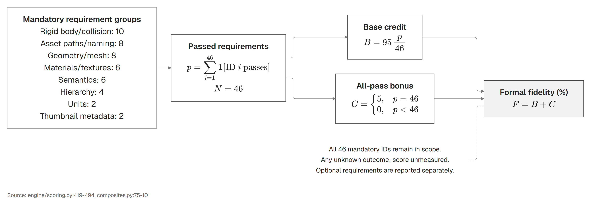
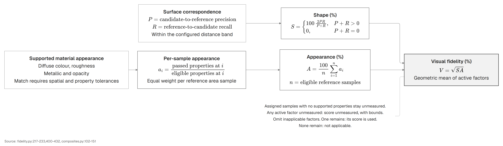
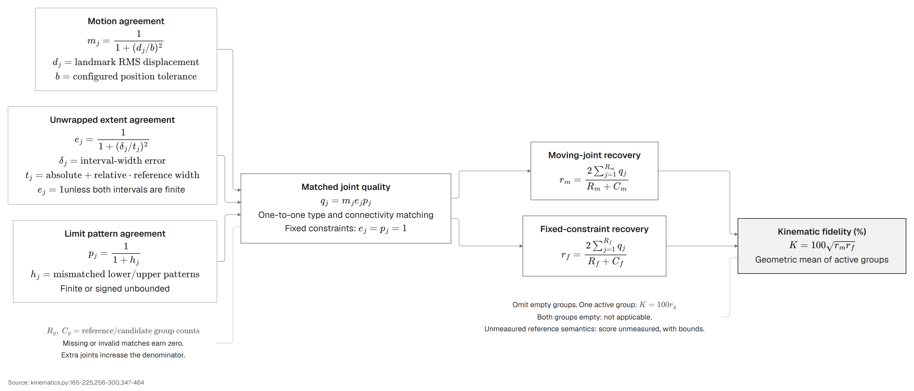

# Scoring

SimReadyBench reports three independent composite scores on a 0-100 scale. Formal fidelity measures the submitted asset against the [NVIDIA SimReady-Foundation Robotics-Prop 4.0.0 profile](https://github.com/NVIDIA/simready-foundation/blob/main/nv_core/sr_specs/docs/guides/profiles_validation_workflow.md), visual fidelity measures its shape and appearance and kinematic fidelity measures its joints and allowed motion. Orientation-aligned captures show the reference and candidate from shared cameras at the same physical scale.

| Composite | Factors |
|---|---|
| Formal fidelity | The 46 mandatory SimReady Robotics-Prop requirements and strict profile pass |
| Visual fidelity | Reference-scale shape and appearance material correspondence |
| Kinematic fidelity | Joint recovery, connectivity and correspondence of allowed relative poses |

The composites are reported independently. Their underlying measurements retain earned credit, eligible denominators, measured counts and coverage. Unknown measurements remain null, while criteria absent from the reference are N/A.

## Formal fidelity

Each of the 46 mandatory requirements has equal weight. For $p$ passed requirements and no unknown outcomes:

$$
F = 95\,\frac{p}{46} +
\begin{cases}
5, & p=46 \\
0, & p<46
\end{cases}
$$

Harbor receives this 0-100 value as `simready_reward`. Strict acceptance requires all 46 mandatory requirements to pass. The requirement roster and rule implementations are specified in [`nvidia_profile.json`](../src/simready_bench/engine/nvidia_profile.json).

Missing or invalid candidate output scores zero against the same 46 requirements. An incomplete evaluator run has a null score with credit bounds. Multiple findings against one requirement count as one failed requirement.

## Optional profile score

The 51 optional Robotics-Prop 4.0.0 requirements receive a separate score:

$$
O = 100\,\frac{p_{\mathrm{optional}}}{51}
$$

The report includes passed, failed and unmeasured counts, evaluation coverage and per-requirement findings. Partially measured evaluations retain their observed counts and score bounds. A confirmed invalid candidate receives zero credit under both mandatory and optional scoring, with its requirement outcomes recorded as invalid. An unavailable validator or incomplete rule execution retains unknown outcomes. Optional requirements do not change the mandatory score or its completion bonus. Their roster and rule implementations are specified in [`nvidia_optional_profile.json`](../src/simready_bench/engine/nvidia_optional_profile.json).

## Visual fidelity

The visual composite is the geometric mean of shape and appearance correspondence:

$$
V = \sqrt{SA}
$$

Here $S$ and $A$ are the shape and appearance percentages.

Shape is the bidirectional surface F-score at the reference scale. Appearance compares supported colour, roughness, metallic response, opacity and texture values at corresponding reference surface samples. Each sample receives the mean of its eligible property matches, then the equal-area samples are averaged. The material-assignment flag, friction, restitution and density do not contribute to appearance credit. Assigned reference regions without measurable appearance inputs retain unknown credit, measurement coverage and lower/upper bounds. A factor with no eligible reference criteria is N/A and is excluded from the mean.

## Kinematic fidelity

The evaluator matches joints one to one through corresponding bodies and compares the relative poses permitted by their constraints. For fixed, revolute and prismatic joints, the constraint transform is `J0 * motion(q) * inverse(J1)`, where `J0` and `J1` are the world joint frames. Seventeen deterministic nonuniform states span each motion probe. Both constraints act on the same reference-body landmarks, so differences in reconstructed surface detail do not count twice as kinematic error.

The root-mean-square landmark displacement $d_j$ gives continuous correspondence credit. Let $D$ be the reference bounding-box diagonal:

$$
\begin{aligned}
b &= 0.001\,\mathrm{m} + 0.01D \\
m_j &= \frac{1}{1+(d_j/b)^2} \\
q_j &= m_j e_j p_j \\
r_g &= \frac{2\sum_{j=1}^{R_g}q_j}{R_g+C_g}
\end{aligned}
$$

Here $R_g$ and $C_g$ are the reference and candidate joint counts in group $g$, while $e_j$ and $p_j$ are range and bound-pattern credit.

For finite ranges, range credit is $e_j = \frac{1}{1+(\delta_j/t_j)^2}$, where $\delta_j$ is span error and $t_j$ is five degrees or 5 mm plus 5% of the reference span. This measures unwrapped travel as well as sampled poses. Bound-pattern credit is $p_j = \frac{1}{1+h_j}$, where $h_j$ counts differing endpoint states. These states distinguish finite, negative unbounded and positive unbounded limits. Fixed constraints have unit range and bound-pattern credit.

Known unbounded revolute joints use a canonical probe spanning one full revolution and prismatic joints use one reference diagonal. A half-bounded probe is anchored at its finite endpoint, while a fully unbounded probe uses a canonical coordinate origin. The authored bounds remain unchanged in the measurement record. Missing, blocked or contradictory bound observations remain unknown.

Type, connectivity and the relevant enabled/kinematic states must agree for a match to receive motion credit. Missing joints receive no credit and additional joints increase the denominator. Fixed attachments and moving joints form separate groups. The kinematic composite is their geometric mean when both groups apply, so fixed attachments cannot compensate for missing movable joints.

For moving-joint recovery $r_m$ and fixed-constraint recovery $r_f$:

$$
K =
\begin{cases}
100\sqrt{r_m r_f}, & \text{both groups apply} \\
100r_g, & \text{one group applies}
\end{cases}
$$

Equivalent axis signs, reversed limits, exchanged joint endpoints and pivots shifted along the same hinge line describe the same motion and retain the same score. Unsupported reference constraints and ambiguous body correspondence remain unknown. A reference with no joints is N/A when the candidate also has none, while additional candidate joints score zero.

This evaluates authored forward kinematics. The detailed report also retains the individual USD joint checks, body states, counts, motion errors and fixed-attachment measurements.

Joint parameters and motion have complementary roles in reconstruction evaluation. [Ditto](https://arxiv.org/html/2202.08227) reports axis-angle and hinge-axis position errors, while [PARIS](https://arxiv.org/html/2308.07391) also measures joint-state errors. [Articulate-Anything](https://arxiv.org/html/2410.13882v1) evaluates type, axis, origin and limits with a thresholded success criterion. [PAct](https://pact-project.github.io/) compares resting and articulated geometry as well as joint parameters. The September 2026 [ArticulateArena preprint](https://arxiv.org/abs/2609.33931) develops a representation-invariant distance over joint motions and kinematic trees. SimReadyBench uses the explicit sampled-pose score defined above.

## Detailed correspondence measurements

The evaluator compares the submitted USD with measurements defined by the reference asset. The detailed factors are evaluated on CPU:

| Factor | Measurement |
|---|---|
| Shape | Bidirectional surface F-score, precision, recall, RMS distance and 95th-percentile distance |
| Rigid parts | Surface agreement for corresponding bodies, combined with body count, joint inventory and enabled/kinematic state checks |
| Joints | Count, type, connectivity, enabled state, anchors, relative frames, axes and limits |
| Materials | Supported Preview Surface values, UV textures and authored friction, restitution, density and combine modes at reference surface samples |

Units and up-axis are normalised to metres/Z-up. A single whole-object yaw and translation align the candidate with the reference. Physical scale and relative part transforms remain fixed, with no scale fitting or independent part fitting. Shape, rigid bodies, joint anchors, axes, frames and material correspondence use the same transform. The captures use this alignment and shared camera positions. Evaluation leaves the generated USD unchanged.

The surface distance band is 1 mm plus 1% of the reference diagonal. Joint anchor bands use the same rule, angular bands are 3 degrees and limit bands are 5 degrees or 5 mm plus 5% of the reference bound magnitude. Material values use an absolute tolerance of 0.05 plus 5% relative tolerance.

Each factor records its score, earned credit, eligible denominator, measured count and reference coverage. Reports include surface precision/recall, rigid-body correspondence, passed joint checks and material-property matches. Absent or unsupported reference fields are N/A, while a candidate omission of an eligible field fails.

## Validator feedback and captures

During authoring, the agent can call `validate_candidate` to receive its numeric score, per-requirement statuses and the full SimReady Robotics-Prop report. The report identifies failed rules, affected prims and suggested corrections.

Storm/Mesa renders orientation-aligned reference and candidate views for visual inspection. The [report](reporting.md) links the scores, captures and generated assets for each attempt.
