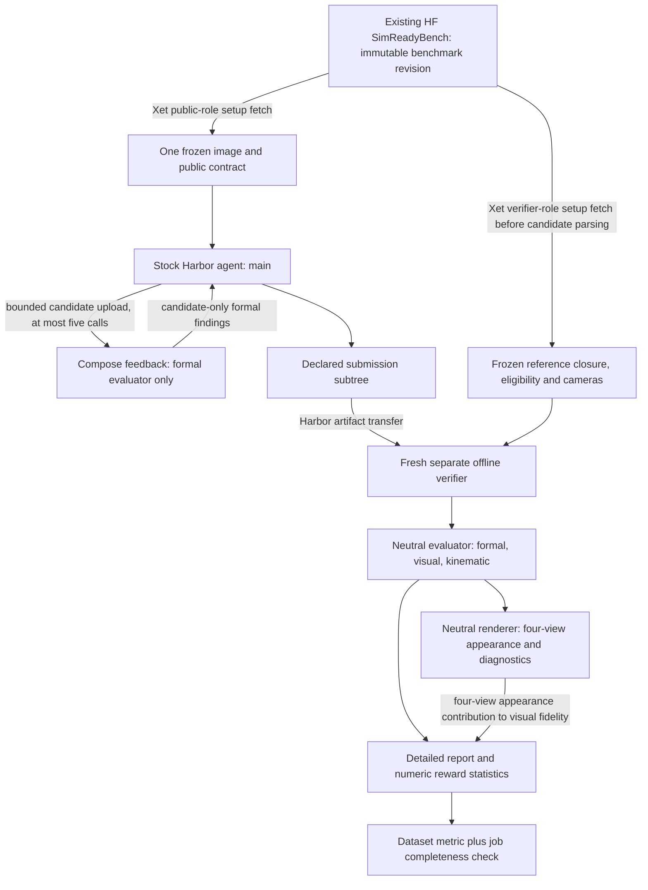

# Native Harbor NV100 - Plan

## Summary

Release a self-contained benchmark dataset under `hcltech-robotics` using ordinary Harbor tasks, a small independent evaluator, a five-call formal-feedback Compose service, and a separate final verifier that recomputes all three fidelities from submitted files.
Build a clean public distribution from an allowlist into a separate export root; never publish this working repository.
The existing Hugging Face dataset `hcltech-robotics/simreadybench` becomes the authoritative task/description/pre-render asset store; small Harbor packages fetch only their own role-specific files through Xet at a frozen dataset commit.
Preserve existing leaderboard results under `results/` in that same repository and move their readers/writers to the prefix. Live migration and deletion remain pending separate authorization.
Keep formal, visual and kinematic as three separate scores, with measurement coverage and unknowns.
The user has settled that visual fidelity requires both real 3D geometry and appearance; four rendered views alone must not reward a textured billboard.
The recommended visual formula keeps the existing geometric-mean structure, combining full-surface 3D correspondence with four-view rendered appearance; material correspondence remains a coverage-qualified diagnostic.
Do not introduce an overall weighted score in this port.

The user approved local implementation of this design on 2026-10-25 at 15:03 UTC.
The implementation is under `native/`; current interfaces are in `native/README.md`
and actual verification/blockers are in `docs/native-harbor-verification.md`.
That approval does not authorize model runs, stopped private-runner changes,
live HF migration or public uploads.
The asset-selection task owns the final roster, qualification and frozen reference renders.

---

## Goal Capsule

**Outcome:** someone with Harbor 0.24.0 and Linux Docker/Compose can download the dataset by digest, run an ordinary multimodal agent, and obtain reproducible formal, visual and kinematic results without a private host, custom lifecycle, model gateway or private application.

**Source baseline:** SimReadyBench commit `ad38697277f897833ee9a19e329f99063827de1f`, clean before this plan was added; Harbor 0.24.0 commit `b53b8134e1241686dca7759af188f987ecc48e8b`.
No applicable `AGENTS.md` was present at the workspace/repository roots or in the owned source directories.
The two repository `.agents/skills/run-simreadybench-{custom,nv25}/SKILL.md` operator guides were read; their relevant scientific constraints are independent fidelities, fixed scientific inputs, retained coverage, and infrastructure failures distinct from low scores.
Their experiment-running instructions do not authorize a run here.

**Stop conditions for the eventual release:** no unresolved score-contract choice, unsupported selected reference, unverified v7/v8 regression implementation, unverified runtime dependency, or incomplete export inventory.
Planning can finish while these release prerequisites remain open.

---

## Product Contract

### Problem Frame

Current generated tasks look like Harbor tasks but depend on an injected Unix service and trusted-host evaluator.
Their final Harbor reward describes formal conformance, while source correspondence and rendering are separate postprocessing paths.
A direct upload would neither be portable nor faithfully communicate three-fidelity evaluation.

### Requirements

| ID | Requirement |
|---|---|
| R1 | Publish only the clean NV100 benchmark under Harbor Hub owner `hcltech-robotics`; exclude the working repository and all Orichalcum code, adapters, prompts, traces, results and artifacts. |
| R2 | Consume the separately frozen 100 articulated assets: exact NV25 exclusions, pinned NVIDIA source collection, quotas 40 workshop / 28 hospital / 10 warehouse / 9 parts / 13 other, one family each where possible. Do not select assets here. |
| R3 | Expose exactly one frozen reference image to the running agent, together with the task/output/scoring contract. Keep the four frozen comparison images and reference USD out of the agent environment and feedback responses. |
| R4 | Use stock Harbor agent execution and Docker Compose services, with no injected host socket, private runner, custom agent adapter, model relay or provider accounting dependency. |
| R5 | Enforce five formal-feedback calls on the server; final verification is independent and consumes none of those calls. |
| R6 | Preserve formal, visual and kinematic fidelity, including raw measurements, denominators, bounds and coverage; do not silently substitute formal-only grading. |
| R7 | Recompute final scores in a fresh separate verifier using only the declared candidate submission and evaluator-owned frozen fixtures; never trust an agent-written report or a feedback-service score cache. |
| R8 | Distinguish proven bad/missing candidate output from unavailable infrastructure and unsupported reference measurements. |
| R9 | Pin task/dataset content digests, complete asset closures and evaluator/renderer OCI digests; record all scientific settings. |
| R10 | Provide a neutral renderer with exact frozen cameras, independent of private applications and frontend assets. Its four-view appearance comparison contributes to visual fidelity together with real 3D geometry; preserve separate observed/novel diagnostics and test a four-fold textured billboard. |
| R11 | Use the existing SimReadyBench HF dataset for clean `benchmark/` data and preserved historical `results/`, using task-selective Xet fetches pinned to a full immutable revision and per-file checksums. Keep leaderboard readers/writers in the same repository with explicit results prefixes. |

The NVIDIA collection currently pinned by `engine/acquisition.py` is `nvidia/simready-assets` revision `f4860aa0c75607adb50a78bf96e77510bffc040f`.
The roster owner must bind each selected package's full dependency closure, not just its top USD hash, to that source revision.

---

## Inspection Findings

### Actual dependency graph and extraction boundary

Paths below refer to `src/simready_bench/` unless otherwise stated.

| Existing surface | Actual role/dependencies | Port treatment |
|---|---|---|
| `assets.py` task generator | Writes schema 1.4 tasks, one thumbnail, formal policy, separate verifier and whole `/output` artifact; `tests/test.sh` calls the injected socket. | Replace with a small clean exporter; retain contract intent only. |
| `engine/harbor_services.py` | `ReferenceNativeServices` imports lifecycle, controller, gateways, actor tools and exact `Evaluator` type; dynamically writes verifier script/token and opens `service.sock`. | Exclude wholesale. New small feedback server has no dependency on these modules. |
| `engine/evaluation.py` | Hostname/execution-enable guard, validator Python/source paths, snapshot identity, SQLite cache/final records, `CandidateObserver` process management. | Replace orchestration with a file-based evaluator entry point and bounded subprocesses. |
| `engine/scoring.py` | Formal pure projection plus NVIDIA observation, report filtering, evaluator DB orchestration and native invalid-proof code. Imports policy helpers from `verifier.py`; native proof tail imports `harbor.py`. | Extract pure formal math/reporting and genuine validator dispatch; do not copy the whole module into the public wheel. |
| `engine/validator.py`, `nvidia_{optional_,}profile.json` | Genuine NVIDIA dispatch, SDK inventories/source hashes, mandatory/optional requirement outcomes. Imports `nvidia_compat.py` for a narrowly scoped material-terminal reader guard. | Public, audited evaluator-only implementation and manifests. Preserve source identities. |
| `engine/package_checks.py` | Offline filesystem/archive/dependency scan before composition; stdlib, OpenUSD, XML handling. | Reuse relevant neutral checks under the new evaluator package. |
| `engine/snapshots.py`, `contracts.py`, `candidate_export.py` | Snapshot/file representations and hardened package capture; some representations are coupled to episode identity. | Extract file-safety/hash primitives only; no episode/controller imports. |
| `fidelity_worker.py` | `usd_geometry.observe` → reference eligibility/profile → `fidelity.compare` → `kinematics.compare_kinematics`; package safety before candidate composition. | Core measurement path to keep, with a neutral input contract. |
| `fidelity.py`, `geometry_alignment.py`, `kinematics.py`, `composites.py` | NumPy numerical measurements, deterministic sampling/assignment/alignment, three independent composites. | Retain scientific semantics and characterization cases; remove condition/run-envelope coupling. |
| `usd_geometry.py` | OpenUSD/NumPy observation, Pillow-backed sampled textures, body/joint extraction; imports neutral malformed-material detection from `nvidia_compat.py`. | Retain and reconcile geometry/material corrections before freezing its version. |
| `fidelity_control.py`, `captures.py` | Launch sibling Docker containers from the host, bind trusted repository/reference directories, use private run layout/runtime config. | Exclude wrappers; verifier executes installed workers directly, without Docker-in-Docker. |
| `storm.py` | Full OpenUSD imaging + PyOpenGL + Mesa/Xvfb, shared reference-bound orthographic cameras, candidate rigid alignment, MDL-to-Preview approximation. | Useful neutral camera/material-support precedent; not the paused PBR implementation or a drop-in scoring renderer. |

The existing formal path is `verifier.py → /internal/final` over `/run/simready-verifier/service.sock` → lifecycle-owned final snapshot → `Evaluator.evaluate` → `scoring.evaluate_snapshot` → `CandidateObserver` → package checks/NVIDIA validation.
`verifier.write_verifier_output` emits only `{"simready_reward": <0–100 formal score>}`.
It emits no reward if formal evaluation is unknown.
CPU fidelity is separately optional (`fidelity.DEFAULTS.enabled=False`), and Storm explicitly declares `illustration_only=True, scoring=False`.
These are concrete reasons not to ship the current generated tasks.

There is also a coverage trap: formal `profile_coverage_fraction` means the selected profile scope, currently 46/46, while execution coverage is `(passed+failed)/46`.
`composites.scores` currently prefers the former when deriving its formal coverage.
The port must retain **both** fields with distinct names and use execution coverage for measurement reporting.

### Current clocks and limits

The controller defaults to 1,800 seconds per episode, five validation calls, 12 preview calls and 128 inference calls, but generated experiment settings override these defaults.
Validation jobs have a 120-second cap, previews 90 seconds, and snapshots a five-second monotonic cap further limited by the request/episode deadline.
The final service commonly uses 600 seconds, with nested 580/590-second service/client limits.
`CandidateObserver` enforces absolute deadlines with `time.time()` and measures elapsed duration with `time.monotonic()`.
CPU fidelity defaults to 300 seconds and 2,048 area samples in each direction, in a 2 CPU / 2 GiB worker; illustration defaults are 512 pixels / 180 seconds, with a separate configurable memory limit.

The normal 64-turn authoring allowance is **231,000 seconds (64 hours 10 minutes)**: `64*(1800+1800)+600` in `engine/native_output.py`.
Preserve the existing frozen task's authoring allowance rather than introduce a shorter Hub wall-time protocol.
Harbor wall time, model-call count, token limits and monetary budget are distinct quantities; carry applicable agent-specific turn/token settings through ordinary runner configuration where supported and record any genuine unsupported limit rather than adding a custom harness.

---

## Planning Contract

### KTD1. One neutral evaluator package, two thin Harbor entry points

Create a small `simready_eval` package with no imports of Harbor, agent SDKs, Pi, Daytona, private source roots, inference gateways, controllers, reporting sites or result publishers.
Its file-based inputs are a validated candidate directory/entrypoint, evaluator-owned reference closure/eligibility profile, and a versioned scoring contract.
Its output is a typed JSON report containing input/config/code hashes, component statuses, measurements, bounds and errors.
Content identity must not depend on absolute host paths, hostname, episode IDs or wall timestamps.

Use the same package for formal-only feedback and full final evaluation.
The evaluator owns the profile and reference, not a client-supplied config.
Reference eligibility and supported scopes are frozen before candidate authoring.
Workers run as ordinary bounded subprocesses within the verifier/service container; no host sockets or nested Docker invocation.

### KTD2. Normal main container, candidate upload to an isolated feedback service

`environment/docker-compose.yaml` declares Harbor's reserved `main` service and a `feedback` sidecar on an explicitly declared internal task network.
Use service DNS with a small public CLI, e.g. `validate_candidate --request-id … --package …`.
Do not expose ports on the host, mount Docker's socket, use external volumes or depend on a host checkout.
No shared writable candidate directory is required: the client uploads a bounded package; the server snapshots, scans and hashes it before evaluation.
The sidecar image contains only the formal evaluator and public scoring contract, with **no target USD or comparison images**.

Main contains a normal Linux terminal, Python/OpenUSD authoring tools, Pillow/NumPy, the feedback client and the one image acquired during its trusted build/setup per KTD7.
The instruction names the image path and asks the agent to inspect it using its ordinary image tools.
No image-only custom harness or mandatory Pi extension is needed.
Task-specific names/metadata must not expose source filenames or reference paths that bypass the observation task.
Public nominal dimensions, if retained from the existing protocol, must be explicitly included in the frozen task contract (see decisions).

The server keeps one private per-trial SQLite ledger in a service-only named volume.
Its atomic admission rules are: a fresh well-formed request consumes one of five slots, including a proven invalid package or timed-out evaluation; repeating the same request ID and package digest returns the existing result without another charge; reusing an ID with different bytes is rejected; a sixth new request is rejected.
Malformed transport requests never start an evaluator.
Concurrent requests cannot exceed five admissions, and sidecar restart cannot reset the counter.
Transport retries cannot create new scientific attempts or refresh deadlines.
Each admitted call has a 120-second server deadline; final evaluation has its own budget.

Compose is deployment wiring, not the enforcement mechanism.
The server must bind its one trial identity itself, keep the ledger inaccessible to main, and prevent candidate-processing workers from modifying the service's ledger or control state.
A client-side counter, client-selected trial identity, agent-writable state volume or restart-reset counter would make the limit bypassable.
Native USD/validator parsing is an untrusted-input boundary; isolate the bounded worker from service control state rather than assuming a subprocess alone protects it.
An operator who controls Docker or edits the public task can still reset or alter a local run: the five-call claim applies to an unmodified trusted Harbor execution, not to cryptographic enforcement against its host operator.

The response contains candidate-only formal mandatory/optional scores and the sanitized genuine NVIDIA findings/report.
Do not expose hidden reference comparisons, target dimensions beyond the public contract, comparison renders, raw host paths or private logs.
Do not add visual/kinematic feedback as an accidental new information channel.
There is no benchmark preview endpoint; an agent can render its own candidate locally.

Harbor egress-control rewriting can change implicit Compose networking: explicitly authored task networks are respected, while default services may otherwise share an egress-control namespace.
The supported initial target is **Linux Docker/Compose**, with an effective-network smoke check; do not claim all Harbor environment providers support this topology.
[Pinned Docker implementation](https://github.com/harbor-framework/harbor/blob/b53b8134e1241686dca7759af188f987ecc48e8b/src/harbor/environments/docker/docker.py), [multi-container docs](https://docs.harborframework.com/tasks/multi-container).

### KTD3. Fresh final verifier, narrow submission boundary

Set task schema `1.4` and `verifier.environment_mode="separate"` explicitly.
Bake the installed evaluator and `/tests/test.sh` into the dedicated verifier environment, and acquire only that task's fixtures through Xet during its trusted Dockerfile build/setup per KTD7.
The Hub task package contains the small pinned fetch recipe/manifests rather than fixture payloads.
Harbor does not upload tests into a dedicated verifier image.
The verifier has no network and no feedback endpoint/token dependency.

Declare one candidate subtree, proposed container source `/output/submission`, collected to host destination `candidate`; require `/output/submission/asset.usd` and package-local dependencies.
Work scripts belong outside this subtree.
At final evaluation, accept only that restored source path and evaluator-owned fixtures; ignore arbitrary `/output`, agent logs and `/logs/artifacts` even though Harbor also transfers the latter automatically.
Host `destination` is not the restored verifier path: Harbor restores an artifact at its original `source` path.
Test that exact mapping, rather than guessing the candidate is mounted at `/candidate`.
[Pinned separate-verifier contract](https://github.com/harbor-framework/harbor/blob/b53b8134e1241686dca7759af188f987ecc48e8b/docs-mintlify/tasks/separate-verifier.mdx).

Freeze the entire accepted submission into verifier-owned immutable storage before any composition, hash all files, scan dependencies before loading USD, and verify hashes after evaluation.
Retain current bounds of 256 MiB and 10,000 entries, no symlinks/hardlinks/special files, local dependencies only, safe archive expansion, and no submitted executable dependencies.
Keep archive expanded-size and decoded texture/surface allocation bounds as distinct limits.
Never execute the submitted package.
The final verifier recomputes formal, visual and kinematic evidence, even if the same digest received feedback earlier.
It has no need to read the feedback ledger for scoring.

### KTD4. Three separate scores; visual requires both appearance and real geometry

**Formal:** all 46 mandatory Robotics-Prop 4.0.0 requirements, equal base credit with five-point completion bonus: `F = 95*p/46 + 5*I[p=46]`, when all outcomes are known.
Unknown requirement execution gives null F, fixed denominator and bounds; confirmed invalid/missing submission gives zero.
Keep strict official conformance separate and retain the 51 optional requirements as report-only `100*p_optional/51`.
Do not filter requirements or make six mandatory semantic-label requirements informational.

**Settled product decision:** retain three separate scores and combine appearance with genuine 3D geometry for visual fidelity. Local implementation was subsequently approved; no overall F/V/K weighting was introduced.

**Recommended visual formula, all terms on a 0–100 scale:**

`G = existing full-surface 3D geometry F-score`

`R4 = (R_isometric + R_front + R_side + R_top) / 4`

`V = sqrt(G * R4)`

The four view labels refer to their frozen camera IDs; if the supplied rig uses different names, retain its four exact IDs.
G keeps bidirectional point-to-triangle surface precision/recall, the `1 mm + 1% of reference diagonal` band and deterministic area sampling (seeds 142/143).
It samples the entire supported 3D surface, including surfaces occluded from the four cameras, not silhouettes, depth from only those cameras, or reconstructed image planes.
The same single geometry-derived whole-object yaw/translation is used for all four rendered comparisons, with no view-dependent pose, scale, crop, exposure, image registration or candidate auto-framing.
Thus V is high only when both 3D surface correspondence and rendered appearance are high; if either is zero, V is zero.
Even perfect rendered appearance cannot produce V=100 without G=100; for example, G=9/R4=100 gives V=30, not a successful reconstruction.
Report G and every R_v alongside V so the reason for low credit is visible.

**Recommended deterministic per-view appearance comparison:** `R_v = 100 * clip(mean_RGB_SSIM_on_foreground_union, 0, 1)`.
Compute local SSIM separately for each RGB channel on the frozen sRGB output in [0,1], with an 11x11 normalized Gaussian window (sigma 1.5), population moments, reflect padding, C1=0.01^2 and C2=0.03^2; average channel/window-center results over the mask before clipping.
Use the standard expression `(2*mu_ref*mu_cand+C1)*(2*cov+C2) / ((mu_ref^2+mu_cand^2+C1)*(var_ref+var_cand+C2))`.
Coverage masks come from an object-ID/coverage pass independent of material opacity, with foreground defined as nonzero object coverage and a nonempty frozen reference mask required; a transparent candidate cannot erase the scored foreground, and empty background cannot dominate the image score.
Use the frozen resolution (current 512-pixel illustration default unless the supplied reference rig specifies another), lights, background, colour transform and camera for both images.
This RGB/masked pooling policy is a benchmark specification, not a claim that SSIM alone verifies geometry; the separate G term does that.
The primary SSIM reference is [Wang et al.'s paper and reference implementation](https://ece.uwaterloo.ca/~z70wang/research/ssim/).

All four frozen comparison renders contribute equally to R4 and remain hidden from the live agent.
Their geometries/materials/cameras must match the frozen render recipe; mismatched legacy PNGs cannot be treated as exact-comparison fixtures.
Retain each comparison camera's R_v and their equal mean as diagnostics, with no extra view weights. The separately frozen fifth observation image/camera/receipt establishes the actual input provenance; it is not one of these four scored references.
Do not skip a failed or unsupported render and average the survivors: R4 and V remain unknown, with known-view credit, fixed four-view denominator and lower/upper bounds retained.
Unexpected renderer/material support failure is not candidate zero; a proven invalid submission still receives the established invalid-candidate treatment.
The visual measurement coverage retains geometry coverage and per-view measurement availability separately; its summary is their equal-factor mean, while visual_known requires a complete required measurement.

**Existing material correspondence remains diagnostic, not an extra appearance reward.** The old visual composite is `sqrt(S*A_material)`, with A_material averaging eligible colour/roughness/metallic/opacity/texture property matches at equal-area reference samples (absolute 0.05 + 5% relative tolerance).
Do not average that sparse proxy with R4: `fidelity._appearance_component` currently marks a sample measured if it has any visual property, so adding opaque-default coverage alone can yield 100% while base colour, roughness or metallic response remain unreadable.
Keep per-property matched/eligible/measured counts, reference-area coverage, default-vs-authored-vs-connected provenance and raw supported-field correspondence.
Resolve valid defaults for a recognized supported Preview Surface; never infer colour/material support from an opacity default or substitute defaults for unsupported connections/MDL.
Report any supported-only percentage explicitly as conditional; report full material-appearance correspondence unknown when applicable reference appearance fields are unmeasured.
Candidate omission of a measurable reference property remains a failed diagnostic, not a dropped denominator.
Material assignment and physical friction/restitution/density do not earn appearance credit.
Faithful rendered appearance can be fully measured even when independent authored-material introspection is partial; preserve that distinction rather than forcing equal shader graphs or rewarding opacity-only introspection.
Version the changed visual definition explicitly (proposed `nv100-visual-surface-render-v1`); do not label it the unchanged legacy material-correspondence composite.
Report supported surface scope as well as numeric G; unsupported reference geometry must not masquerade as full coverage.

**Kinematic:** preserve the existing one-to-one body-conditioned joint correspondence and authored forward-kinematic motion metric.
For each matched joint use 17 deterministic nonuniform states, shared reference-body landmarks and `J0*motion(q)*inverse(J1)`.
Motion credit is `1/(1+(RMS/b)^2)` with `b=1 mm+1% diagonal`; multiply by unwrapped-range and endpoint-pattern credit.
Each moving/fixed group has `r=2*sum(joint quality)/(reference count+candidate count)`; K is `100*sqrt(r_moving*r_fixed)` when both apply, or `100*r` for one group.
Fixed attachments cannot compensate for missing moving joints.
Preserve finite, locked, half-bounded and unbounded treatment, range tolerances (5 degrees + 5% of reference angular span, or 5 mm + 5% of reference linear span), endpoint/axis equivalences, missing/extra counts and unknown ambiguous/unsupported reference constraints.
All NV100 references must have usable articulation; an unexpected N/A kinematic scope is a fixture error requiring review, not a passing zero-joint task.

Normalise metres/Z-up and apply one deterministic whole-object yaw/translation to shape, bodies, joints, materials and aligned render diagnostics.
No scale fitting or independent part fitting.
Record the alignment and raw pre-alignment diagnostics; preserve physical scale.
The current four-factor detailed `fidelity` diagnostics are not a replacement aggregate reward.
Reference definitions: `docs/evaluation.md`, `composites.py`, `fidelity.py`, `kinematics.py`, `geometry_alignment.py` at the source baseline.

### KTD5. Explicit rewards and a dataset metric that understands unknowns

Write `/logs/verifier/report.json` as the authoritative detailed record and `/logs/verifier/reward.json` as numeric sufficient statistics for aggregation.
Keep raw scientific percentages, statuses, earned/eligible/measured counts, bounds, profile scope, measurement coverage, reference-supported scope and provenance in the report.
Do not use `simready_reward` as an ambiguous new overall score; it currently means formal only.
Do not publish a combined F/V/K weight without a separate scientific decision.

Recommended reward contract `nv100-three-fidelities-v1`: for each `d` in `formal`, `visual`, `kinematic`, emit **every** scalar below on every valid evaluator response.

| Reward key suffix | Meaning / range |
|---|---|
| `d_known_credit` | `score_percent/100` if the dimension is fully measured; otherwise a numeric bookkeeping placeholder 0. This is not an unconditional score. |
| `d_known` | 1 for fully measured, including proven candidate failure scored zero; 0 for unknown. |
| `d_measurement_coverage` | Measured/eligible coverage under that dimension's declared scope, in [0,1]. Keep support coverage separately in the report. |
| `d_lower` | Conservative normalized score lower bound under the fixed scope, in [0,1]. |
| `d_upper` | Conservative normalized upper bound, in [0,1]. |

Also emit `contract_version=1`, `candidate_invalid` (0/1), and `evaluation_complete` (all three known, 0/1).
Unknown d may have useful partial measurements; zero placeholder credit does not erase its bounds or other dimensions' known scores.
For example, F=80%, V unknown with bounds 20–70%/coverage 0.6, K=75% gives formal credit/known `(0.8,1)`, visual `(0,0)` with `(lower,upper,coverage)=(0.2,0.7,0.6)`, and kinematic `(0.75,1)`.
All three records remain present.

`metric.py` is a stdlib-only PEP 723 script (`dependencies=[]`), reading Harbor reward JSONL and writing numeric metrics.
It validates the fixed full key set, version, finiteness/ranges, known-bit consistency and bounds before aggregation.
Malformed reward records become explicit invalid-contract/evaluator-unknown counts; they never become candidate failure.
For N attempted trials, each dimension reports `sum(known_credit)/sum(known)` under the name `d_fidelity_mean_known`, known/unknown counts, known fraction, mean measurement coverage, and dataset lower/upper means over N.
Use percentages in the final metric names/output for continuity with scientific reporting.
When the known denominator is zero, omit the mean key and emit `d_mean_available=0`; do not invent a numeric mean.
Otherwise emit `d_mean_available=1`.
For missing/null trial rewards, contribute zero known/coverage, bounds [0,1] for each required dimension, and increment an unavailable-verifier count.
These include infrastructure interruptions until the trial error record establishes the precise cause.

The stock Mean averages each reward key independently and fills missing values with zero; these sufficient-statistic fields therefore must not be used as an unlabelled leaderboard score.
The custom metric produces the scientific outputs and reports completeness beside them.
An official result requires all expected tasks/attempts and full required measurement coverage; partial means are explicitly provisional.
[Pinned aggregation source](https://github.com/harbor-framework/harbor/blob/b53b8134e1241686dca7759af188f987ecc48e8b/src/harbor/metrics/base.py).

Harbor's custom metric receives **only reward dicts/nulls**, not `report.json`, task IDs, exception records or planned-but-never-started tasks.
It cannot enforce roster membership, balance repeated attempts, compute per-family statistics or identify all missing scheduled tasks by itself.
The offline result completeness check compares job/trial metadata with the frozen roster and the actual requested runner job before a result is called complete.
Repetitions remain a runner-level choice: task packages and the metric impose no mandatory count or new equal-repetition policy.
The reward-only metric aggregates supplied attempts; record requested/observed attempt counts and label that mean as attempt-weighted when counts differ across assets.
[Metric execution source](https://github.com/harbor-framework/harbor/blob/b53b8134e1241686dca7759af188f987ecc48e8b/src/harbor/metrics/uv_script.py).

The dataset uses schema `1.0`, references all 100 tasks by `hcltech-robotics/<task>@sha256:…` content identity through its name/digest fields, and includes `metric.py` as a dataset file.
Important 0.24.0 discrepancy: Hub package resolution loads this metric automatically; local dataset-path resolution does not.
Local acceptance jobs must explicitly configure metric type `uv-script` and `kwargs.script_path` to the exported metric.
Hub jobs use `DatasetConfig(name="hcltech-robotics/<dataset>", ref="sha256:…")`.
[Pinned job resolver](https://github.com/harbor-framework/harbor/blob/b53b8134e1241686dca7759af188f987ecc48e8b/src/harbor/job.py), [dataset schema](https://github.com/harbor-framework/harbor/blob/b53b8134e1241686dca7759af188f987ecc48e8b/src/harbor/models/dataset/manifest.py).

### KTD6. A genuinely neutral renderer, with a frozen camera contract

The paused rehearsal PBR script imports `orichalcum_render_host` and uses private application/frontend assets, according to the explicit handoff.
Do not import it, vendor it, rename its adapter, depend on its application server, or reuse its saved outputs as a clean runtime dependency.
It was not present in this checkout and was not inspected or executed here.

Recommended replacement: a standalone OpenUSD scene-extraction module plus a small headless Blender/Cycles CPU renderer, installed from public pinned releases and OCI digests.
Use a documented neutral mesh/material/camera manifest between extraction and rendering; no browser/frontend application is necessary.
This is new benchmark-owned implementation, not a renamed private renderer.
Preserve per-face material assignment, per-corner UV/normal provenance, world transforms, units/up-axis, textures and supported Preview Surface values; publish exactly what the bridge supports.
Unsupported materials must be identified in the receipt instead of silently replaced by gray.
MDL-only reference materials require a separately approved public conversion/bake or explicit unknown appearance coverage; the existing Storm diffuse approximation is unsuitable as evidence of faithful PBR appearance.
Renderer version, CPU backend, samples, seed, colour management, lighting/environment, resolution, clipping and alpha policy all enter the render identity.
Exact Blender version/digest and performance are implementation-time pins, not claimed as established by this inspection.

Accept frozen `cameras.json`, one observation PNG and four comparison PNGs from the roster/render task.
The explicit observation camera must produce the **single image actually shown to the agent** as its own genuinely rendered frame. Its camera matrix is distinct from all four comparison cameras; freeze all five settings. A single five-camera batch avoids repeating geometry extraction.
If the source thumbnail lacks recoverable camera intrinsics/extrinsics, do not call a newly framed view an exact observed match: the asset task must provide a newly frozen single observation with known camera or flag the missing camera contract.
A candidate must be rendered at those exact reference camera matrices/projection and physical scale, never auto-framed from candidate bounds.
Keep raw posed and globally aligned candidate variants distinct; alignment cannot be presented as an unaltered observed-camera reconstruction.
Persist observation provenance and four comparison diagnostics separately with camera IDs and reference/candidate digests.
Four reference images are verifier-only at runtime and never returned by feedback.
The user has settled that rendered appearance participates alongside real geometry, per KTD4; the proposed per-view SSIM recipe and visual definition must be versioned with the clean benchmark.
There is no combined F/V/K scalar or new observed-versus-novel weighting.

The recovered neutral rehearsal handoff supplies the following regression specifications; implementation and public-fix provenance remain unverified.
No private renderer code is needed or authorized.

**v8 opacity regression contract:** an omitted or unvalued, unconnected `UsdPreviewSurface inputs:opacity` resolves to `1.0`.
Explicit `0`, `0.35` and `1` remain unchanged.
Unsupported connected opacity remains unmeasured and must never default to opaque.
Explicit opaque and omitted-opacity variants must score identically and leave all source hashes unchanged.
Apply the same resolution in the USD appearance observer and neutral renderer bridge.
The inspected observer currently skips a missing input; it does not establish this full policy.
The [OpenUSD Preview Surface specification](https://openusd.org/release/spec_usdpreviewsurface.html) defines the opaque fallback.

**v7 primitive and numerical regression contract:**

- Support `Cylinder`, `Sphere`, `Cone`, `Capsule`, `Cylinder_1`, `Capsule_1` and `Plane`, preserving authored axes, composed transforms, units/up-axis, body ownership and material bindings.
- Use deterministic tessellation with 128 radial segments and 32 hemisphere segments where applicable.
- A cylinder with radius 2 and height 3 has area `20*pi` and volume `12*pi`, each within 0.1%; caps represent 40% of expected area-sampling mass. Validate repeated sampling and the exact cap sample-count acceptance tolerance in the neutral fixture rather than assuming random draws give exactly 40%.
- For near-coincident quad poles with shortest edge at most `32*machine_epsilon*polygon_scale`, use robust exact orientation/intersection decisions without welding, snapping or loss of UV corner provenance.
- Thin nonzero-area triangles require stable barycentrics. Truly collapsed triangles require segment/vertex distance handling, with zero surface-area sampling weight. Reject nonfinite input.
- Primitive self-match must score 100%; exercise transformed variants and reproducible repeated sampling.
- `Capsule_1` tangent spherical caps have a pinned GeomUtil qualification issue. A zero-height unequal-radius capsule is not covered by the recovered cases. Neither is silently qualified by a generic primitive self-match; selected assets exercising these cases need an explicit neutral qualification case or remain blocked.

The checkout currently supports Mesh and Cube only and includes some polygon/degeneracy handling; that is not proof of v7 parity.
The recovered provenance pointer is uncommitted local snapshot `296bdee63b5cf89b434b59f346948fd09d7ffb50` in an older workspace, not a verified public fix commit or a new inspected source baseline.
Its full diff includes other joint changes and must not be copied wholesale.
Reproduce the neutral cases independently, publish scope/approximations, and pin the eventual clean implementation commit.

Use the existing neutral Storm implementation only as a fallback **labelled illustration**, if desired after the new renderer is validated; do not silently switch backend within one frozen release.

### KTD7. Existing HF dataset is authoritative; selective Xet acquisition happens in setup

**Selected architecture:** use `https://huggingface.co/datasets/hcltech-robotics/simreadybench`, not a competing benchmark-data repository.
The independent read-only migration inspection reports the current dataset public/ungated at commit `0d19347b23ed31a077f045ca3454bacc5bed1d26`, with 5,450 tracked paths, about 1.69 GB usedStorage, and 606 result rows across 11 parquet runs.
Its live tree currently contains `runs/`, `viewer/`, `media/`, `leaderboard.json`, `viewer-index.json` and `eval.yaml`; four viewer paths include `codex-orichalcum`.
That commit is the **historical migration checkpoint**, not the future NV100 asset revision.
Public visibility and the existing identity are verified by that inspection; selected destinations are `benchmark/` and `results/` in that same repository. Future write authority and the exact clean release content/revision remain unverified and no upload is authorized.

The clean HF `benchmark/` subtree holds task descriptions, one agent observation per task, reference USD/dependency closures, the four comparison renders/camera manifest, eligibility/configuration and source/license provenance.
A possible task-scoped layout is `benchmark/nv100/v1/tasks/<task-id>/{public,reference,comparison}/`; this is one benchmark identity within the existing dataset, not a new repository.
Exclude all historical run outputs, viewer-result rows, private prompts, source/adapters and Orichalcum artifacts from that benchmark subtree and its release manifest.
Existing projected public Orichalcum scores, PNGs and provenance are preserved only as historical results under `results/`; they never become task inputs, fixture downloads or Harbor package contents.
Preserve the upstream NVIDIA source revision separately from the new HF benchmark release revision.

Each Harbor task carries small actor-role and verifier-role manifests specifying repo ID, full 40-character HF revision, exact file paths, sizes and SHA-256 values.
Actor acquisition downloads only its own observation PNG and public task instructions; it receives no global reference manifest or shared reference cache.
Verifier acquisition downloads only its task's reference closure/eligibility/camera data and four comparison PNGs.
Both role manifests are constrained to their task's clean `benchmark/` paths and reject `results/` or any legacy result path; task fetches never download historical results.
Feedback downloads no target data and continues candidate-only formal validation.
Use a pinned `huggingface_hub` plus `hf_xet` fetch helper with exact per-file requests, `repo_type="dataset"`, the full revision, and `token=False` for this public ungated source; never clone/snapshot the whole dataset or resolve `main`/`latest` at runtime.
The official client uses Xet for files stored in that backend; tiny Git-backed descriptions/manifests may use normal Hub responses through the same selective helper.
[HF selective/revision download API](https://huggingface.co/docs/huggingface_hub/guides/download), [Xet integration](https://huggingface.co/docs/hub/xet/using-xet-storage).

**Timing decision: acquire during Dockerfile build/environment setup, never inside offline scoring.**
Use generic digest-pinned OCI bases and task-local Dockerfiles; do not set a bare generic prebuilt `environment.docker_image` that bypasses the task's fetch/build step.
Main's build fetches its public files before agent execution.
Harbor 0.24.0 starts/builds the separate verifier environment before uploading candidate artifacts, then invokes the verifier with its scoring timeout; use that ordering to fetch/check fixtures before any candidate parsing.
This separate verifier setup normally occurs after authoring, not before it; there is no invented pre-agent verifier lifecycle.
No candidate file or candidate-supplied path/config is present in the acquisition step.
After setup, verifier scoring is fully offline and cannot fetch missing dependencies opportunistically.
Build/setup transfer time uses the existing environment-build allowance, not the authoring/final scientific budgets; acquisition failure is infrastructure unknown.
Local build layers may cache only the selected per-task assets; HF remains authoritative and the Hub package never embeds the whole collection.
[Pinned separate-verifier ordering](https://github.com/harbor-framework/harbor/blob/b53b8134e1241686dca7759af188f987ecc48e8b/src/harbor/trial/trial.py), [Docker build ordering](https://github.com/harbor-framework/harbor/blob/b53b8134e1241686dca7759af188f987ecc48e8b/src/harbor/environments/docker/docker.py).

The helper uses bounded retries within the setup deadline, per-cache-entry locking, and atomic staging/rename.
Cache identity includes repo, full revision, role-manifest hash and file hashes; a warm exact cache works offline, while a missing/corrupt cache fails or refetches during setup only.
Validate expected sizes and SHA-256 after materializing regular files; do not preserve HF cache symlinks/hardlinks into the evaluator fixture tree.
Validate safe relative paths and complete dependency closure, reject unexpected files, and hash-check the immutable staged fixtures again before candidate composition.
A matching revision/path alone is not a checksum check.
Keep actor and verifier caches/mounts separate; no HF login state, host cache containing other roles, write token, credential build argument or private source directory enters any benchmark image/container.
Scoring workers have read-only fixtures and no fetch capability.
Main's runtime asset egress must deny HF/Xet endpoints while retaining the ordinary agent's required provider access and internal feedback service; fetching public references directly would otherwise bypass the one-image observation boundary.
This is runtime isolation, not a claim that public HF fixtures are secret from the host operator.

**Same-repository results migration, only after authorization:** make an additive hash-verified copy of the complete historical results closure under `results/` before switching readers/writers. No second repository is needed.
Preserve all 11 viewer parquet shards and 606 rows, not merely the nine current `runs/` directories; retain indexes, projected public scores, media/PNGs and provenance without reinterpreting old metrics.
The current index already references GPT Orichalcum pilot and Qwen CSV paths returning 404: record them as pre-existing missing sources, preserve the available shards, and never invent replacement data or reconstruct the archive from `runs/` alone.
Map original paths to copied paths in a checksum receipt, accounting for every tracked source path as unchanged legacy content, a verified results copy or shared repository metadata.
Keep recoverable legacy paths while verifying the cutover; no destructive cleanup is part of this design task.

Change `site/app.js` to read `results/leaderboard.json`, `scripts/build_pareto_data.py` to resolve/read the same prefix, and the six-hour `.github/workflows/pages.yml` availability checks to validate prefixed leaderboard/Pareto inputs.
Prefix `results_url` and index `scores`, `viewer_scores` and grouped paths with `results/`, and update gallery/media links relative to their new locations.
Preserve already SHA-pinned historical explorer URLs as-is; do not blanket-rewrite historical links to a new tree.
The leaderboard remains GitHub Pages; no organization HF Space was found in the inspection.

Keep `--hf-repo` targeting `hcltech-robotics/simreadybench`; make `publishing.py` write historical/new run outputs and results presentation under `results/`.
It currently writes root README and `eval.yaml` too: isolate those result-presentation writes so ordinary result publishing cannot overwrite the root benchmark card or task metadata.
Root HF README describes the benchmark, exposes tasks as the default viewer configuration, and may retain explicitly named historical result configurations pointing to `results/viewer/`.
Make license scopes explicit: the present root MIT label covers code, while upstream asset licensing/provenance (including the current CC BY 4.0 asset-license link) must govern the corresponding task assets; do not relabel assets as MIT by inheritance.

Record the original commit, additive-copy commit, path/hash/count receipt and consumer/producer configuration revision as the immutable rollback checkpoint.
Verify all readers/writers and relative images against the copied data before completing the default-view/card cutover; compare preserved row/shard counts and provenance rather than only a successful HTTP response.
Rollback restores the old reader/writer prefixes/configuration or reads the recorded original revision, without deleting either results or clean benchmark assets.
Historical Git revisions remain historical evidence; only the clean benchmark allowlist enters task fetches and Hub packaging.
No copying, deletion, history rewrite, visibility change or migration occurs during this design task.

### Architecture sketch

---

## Resource Envelope and Failure Semantics

Recommended starting envelope below is **provisional**, requiring clean-container calibration before protocol freeze.
No model or container execution was performed to establish performance here.

| Component | CPU | RAM | Writable storage | Budget / behavior |
|---|---:|---:|---:|---|
| Agent main | 4 vCPU | 16 GiB | 8 GiB | Preserve the frozen task's agent_seconds; current normal 64-turn allowance is 231,000 s. Carry native agent limits through runner settings where supported. |
| Feedback sidecar | 2 vCPU | 8 GiB | 4 GiB | Five calls; 120 s/call; serial worker; bounded queue/upload/logs. |
| Separate verifier | 4 vCPU | 16 GiB | 8 GiB | Preserve existing final_seconds, currently 600 s. Existing worker caps (formal feedback 120 s, correspondence 300 s, illustrations 180 s) remain bounded by the one remaining final deadline. |
| Submitted package | — | — | 256 MiB | 10,000 entries; independent expanded/decoded allocations bounded. |

Use zero GPUs throughout and single-threaded NumPy/BLAS where determinism/resource control requires it.
The initial host recommendation is at least 8 vCPU / 32 GiB RAM / 40 GiB free disk per concurrent trial, excluding pulled-image storage; confirm actual Compose scheduling and overlap before accepting this bound.
Use `cpus`, `memory_mb`, `storage_mb`, `gpus` in Harbor resources and explicit sidecar limits in Compose.
Do not introduce a new one-hour or 900-second protocol as part of packaging.
Only a measured clean-execution failure to fit the retained allowance justifies returning a concrete resource/time portability issue; do not silently shorten authoring, omit a dimension, or extend the budget.
[Pinned task configuration](https://github.com/harbor-framework/harbor/blob/b53b8134e1241686dca7759af188f987ecc48e8b/src/harbor/models/task/config.py).

Elapsed/deadline enforcement inside workers uses monotonic time; UTC wall time is audit metadata only.
Agent wall time includes feedback waiting; no hidden pause or recharge.
Sidecar readiness/build time is an infrastructure phase before authoring; its startup clock is not a second scientific authoring allowance.
The five-call ledger needs no independent authoring clock: stock Harbor owns agent lifetime, while the service owns per-call limits.
Final workers share one total deadline and cannot each restart the full budget.
A required render failure now makes rendered appearance and visual fidelity unknown while retaining known geometry, formal and kinematic measurements, bounds and per-view coverage.

| Observation | Classification |
|---|---|
| Declared submission absent after a successfully observed agent environment; bad topology/dependency closure; proven package limit violation | Candidate failure; retain measured zero where the public scoring contract defines it. |
| Missing candidate joint or wrong permitted motion with a supported reference | Measured kinematic loss, including missing/extra denominator effects. |
| Candidate uses a valid USD primitive outside the published evaluator support | Handle through the frozen support contract; do not call it infrastructure failure or quietly drop it. Fix support or disclose the scope before release. |
| Artifact download/capture failure, missing validator package/plugin, source identity mismatch, OOM, worker deadline or unexpected crash | Infrastructure/evaluator unknown with reason, partial measurements and bounds; never inferred candidate zero. |
| Unsupported/ambiguous reference material or articulation | Reference-supported scope/unknown; blocks a claim of fully measured NV100 until qualified or explicitly accepted. |
| Missing reward because the entire verifier failed | Null trial reward; metric reports unavailable verifier and [0,1] bounds, with precise cause retained in Harbor trial metadata. |

---

## Minimal Modules and Change Scope

Create the following neutral surfaces; names are proposed and may be combined where that preserves the dependency boundary.
Do not refactor the private/custom runner to make the public port work.

| Proposed files | Existing material / responsibility |
|---|---|
| `src/simready_eval/contract.py` | Frozen policy, report schema, identities, status/bounds validation and reward sufficient statistics; separate these from the socket client. |
| `src/simready_eval/package.py` | Package scanning, safe extraction, immutable file manifest/capture; no episode lifecycle. |
| `src/simready_eval/formal.py`, `profiles/*.json` | Genuine NVIDIA dispatch and formal/optional scoring; scoped public NVIDIA compatibility guard, audited independently of any private adapter. |
| `src/simready_eval/usd.py` | USD observation, textures, geometry/primitive/default handling; reconciliation of v7/v8. |
| `src/simready_eval/correspondence.py`, `kinematics.py`, `composites.py` | Existing surface/material/alignment/joint math and three-dimensional projection, preserving versioned meanings. |
| `src/simready_eval/render.py` | New neutral scene bridge and headless renderer, fixed foreground RGB SSIM/four-view pooling, camera/material support receipts. |
| `src/simready_eval/fetch.py` | Small role-selective Xet/Hub helper: full revision, file checksums, safe materialization, exact cache and bounded setup retries. No runtime writer. |
| `src/simready_eval/cli.py` | Offline formal/full evaluation orchestration, deadlines, subprocess cleanup, report output. |
| `src/simready_eval/feedback.py` | Small candidate-upload server/client and atomic five-call ledger, no private lifecycle/gateway imports. |
| `tools/export_harbor_nv100.py`, `harbor_templates/`, `harbor_templates/metric.py` | Allowlisted export, task/dataset metadata, Docker/Compose recipes, entry points, instructions and public metric. |
| `src/simready_bench/publishing.py`, `site/app.js`, `scripts/build_pareto_data.py`, `.github/workflows/pages.yml`, HF README/configuration | Narrow same-repo results-prefix/card cutover per KTD7; keep existing metric interpretation and pinned historical links. |
| `tests/harbor_native/` | Characterization, package/feedback/metrics tests and clean task integration checks described below. |

The evaluator distribution needs its own small dependency/build manifest and allowlisted wheel contents; the setup-only fetch dependency group pins `huggingface_hub` and `hf_xet` separately from offline numerical workers.
Do not install the current monolithic product wheel in exported containers: it brings Harbor/MCP/transport dependencies and runner modules into the release.
The existing numerical/runtime pins are Python 3.12, NumPy 2.5.4, Pillow 13.0.0 and usd-core 26.8; validate compatible runtime wheels rather than assuming the wheel supplies full OpenUSD imaging.
Formal evaluation additionally needs `simready-foundation-tier-core==2026.8.0`, `simready-validate==2026.8.0`, `usd-validation-nvidia==1.22.0`, `usd-profiles-nvidia==1.22.0`, `physx-usd-schemas==25.11.2.72696984`, and `MaterialX==1.39.5`, with the existing inventory/source-hash checks.
Record distributable licenses/notices and verify clean offline installation/plugin registration before pinning evaluator OCI contents.
No private package server or runtime credential may be required by a downstream user.

---

## Implementation Units

### U0. Preserve results and prepare the same-repository reader/writer cutover

**Files:** the KTD7 migration surfaces above, a small additive path/hash copy manifest, `tests/harbor_native/test_results_prefix.py`.
**Depends on:** separately authorized writes to the verified existing HF dataset; no second repository.
**Approach:** make/verify the additive `results/` copy at the historical checkpoint, then test prefixed readers, galleries/media, publisher output paths and root-card protection before cutover.
**Proof:** retain all 11 viewer shards/606 rows and their original provenance, record already-missing indexed CSVs without invention, preserve SHA-pinned historical URLs, and prevent ordinary results publication from overwriting benchmark metadata.
Keep legacy paths recoverable until cutover works and record original/copy/code revisions for rollback.
The clean benchmark tree, Xet role manifests and Harbor export must exclude every results path regardless of historical projected Orichalcum content retained under `results/`.

### U1. Extract and characterize the neutral evaluator

**Files:** proposed evaluator files above; `tests/harbor_native/test_formal.py`, `test_correspondence.py`, `test_contract.py`.
**Depends on:** no asset roster beyond small synthetic articulated fixtures.
**Approach:** isolate package/formal/fidelity math, then create the full evaluation entry point per KTD1/KTD4/KTD5.
Keep useful cases from existing `test_validator_reward_v1.py`, `test_optional_score.py`, `test_composites.py`, `test_fidelity*.py`, `test_kinematics.py`, `test_geometry_alignment.py`, `test_nvidia_material_compat.py` and `test_package_mdl_preflight.py`.
**Proof:** 46/46=100; 45/46=95*45/46; invalid=0; one uninvoked mandatory rule=null; optional outcomes never change F; execution coverage differs from profile scope; missing/extra/wrong moving joint lowers K; equivalent axis/endpoints preserve K; fixed-only candidate cannot replace moving articulation; yaw changes are aligned and scale errors remain penalized; missing material properties fail while unsupported reference fields preserve unknowns.
Verify import/wheel contents have no runner, agent, Harbor or private dependencies.

### U2. Implement the bounded feedback sidecar

**Files:** `feedback.py`, feedback Dockerfile/Compose template, `tests/harbor_native/test_feedback.py`.
**Depends on:** U1 formal-only mode.
**Approach:** implement KTD2's upload/ledger and candidate-only report boundary.
**Proof:** five concurrent unique admissions maximum; sixth rejected; duplicate ID/digest idempotent; duplicate ID/changed digest rejected; timeout consumes one slot; container restart retains count; malformed archive cannot escape; candidate missing entrypoint is a candidate result; unavailable validator is unknown; no target files or comparison images reachable.
Use a server-owned monotonic per-call deadline and bounded response/log sizes.

### U3. Reconcile geometry/defaults and build the neutral renderer

**Files:** `usd.py`, `render.py`, renderer image recipe, `tests/harbor_native/test_usd_support.py`, `test_render_contract.py`, `test_visual_adversaries.py`.
**Depends on:** the recovered neutral v7/v8 contract in KTD6, resolution of its qualification gaps, and the reference-camera contract.
**Approach:** implement KTD6 independently and connect its four frozen-view comparisons to KTD4's visual formula; retain authored-material diagnostics with property-level coverage.
**Proof:** omitted opacity renders opaque and compares equal to explicit 1; explicit zero remains transparent; unsupported connected opacity remains flagged; primitive dimensions/axes survive; concave polygons retain outline; face-corner UV/material provenance survives triangulation; instances, repeated/degenerate/nonplanar faces follow the declared policy.
Run every recovered KTD6 primitive/default/numerical regression, including explicit opacity 0/0.35/1, unvalued input, unsupported connected input, cylinder area/volume/cap sampling, near-coincident poles, stable thin-triangle barycentrics and collapsed-triangle distances.
An unchanged fixture rendered from the frozen camera has identical framing; candidate scale change changes apparent size rather than camera distance; observed and novel camera IDs remain distinct; source USD and the single agent image remain unchanged.
Add a four-fold textured-billboard adversary using camera-matched reference textures on crossed planes, plus transparent/double-sided variants, against a genuine volumetric reference.
Even if the rendered comparison is artificially perfect, the full-surface G must remain low and V must follow `sqrt(G*R4)`; no camera-visible-only geometry shortcut may turn it into a self-match.
The correct 3D self-match reaches G=R4=V=100; a wrong-colour full-shape candidate has G=100 but lower R4/V.
An opacity-only readable material may have perfect conditional opacity credit but must retain unknown full material correspondence; it must not raise R4 or V by that diagnostic alone.
Test foreground/background gaming, unsupported connected colour/opacity, a missing required view, four-view equal pooling and unchanged source hashes.
No imports/files/URLs/application services from the paused private PBR path are allowed.

### U4. Export native tasks and metrics into a fresh allowlisted root

**Files:** exporter/templates, `metric.py`, `fetch.py`, `tests/harbor_native/test_export.py`, `test_metric.py`, `test_selective_fetch.py`.
**Depends on:** U1–U3 and the separately approved roster/closures/images/cameras.
**Approach:** one task per asset, schema 1.4, dedicated offline verifier, declared submission, self-contained public environment and honest oracle solution.
The dataset has schema 1.0 and digest-bound tasks/metric.
**Proof:** exact expected task count, exclusions/quota/family receipt matches supplied roster; one image in main and no other reference channel; full expected reward fields; all-known means match raw composites; partial knowns/missing/null/malformed rows retain coverage and bounds; all-unknown means are absent with availability=0; requested attempt counts are recorded from actual runner/trial identities without a mandatory repetition count.
Fetch tests request exactly the actor or verifier allowlist at the frozen revision; exercise cold/warm/offline cache, checksum/size mismatch, interrupted transfer, concurrent cache fill, role-cache separation, path escape and an unavailable HF service.
Verify no actor request retrieves comparison/source/result paths, verifier fixture acquisition precedes candidate upload/parsing, and scoring needs no network.
Explicitly configure local custom metric loading for Harbor 0.24.0.

### U5. Prove self-contained execution and inspect the export

**Files:** `tests/harbor_native/test_clean_task.py`, `test_release_inventory.py`, public README/notices and local acceptance job template.
**Depends on:** U4.
**Approach:** smoke-first package validation on a fresh machine/cache using only the exported bundle and public images; no paid inference needed.
Use scripted candidate fixtures and the standard Harbor oracle mechanism to exercise the real artifact/separate-verifier flow.
The oracle must construct/copy a licensed clean evaluator reference only from its oracle-only solution context, with no privileged runtime path; document any reference formal nonconformance instead of fabricating 100.
**Proof:** remove the checkout/private directories from reach, start standard Harbor Docker/Compose, use feedback, submit, transfer artifacts, start fresh verifier and load metric; no missing host mounts/sockets/private import can be tolerated.
Compare good, corrupted, absent and unsupported candidates, and independently recompute final results rather than accepting feedback/agent report caches.
Check effective offline networking, restart cleanup, aggregate peak resources and deadline behavior.
Run the deterministic scripted oracle over all 100 frozen tasks once the separate roster qualification is complete; this verifies packaging/transfer/grading, not a duplicate asset-selection project.

---

## Export Layout and Publication Boundary

Use a fresh sibling directory such as `../simreadybench-nv100-harbor-export`, outside this Git repository and outside every private run directory.
Only the exporter writes it, from explicit allowed files.
Proposed immediate children are the 100 task directories plus dataset-level `dataset.toml`, `metric.py`, README, license/notices and frozen release manifest.
Within each task: `instruction.md`, `task.toml`, `environment/` (public-role fetch manifest, normal agent recipe/client, Compose/feedback recipe), `tests/` (final entrypoint, evaluator build inputs/verifier-role fetch manifest), `solution/` (clean oracle only).
Large payloads stay in the authoritative HF benchmark revision and are fetched selectively through KTD7; no whole NVIDIA collection or old result tree is embedded in Harbor packages.
Task build inputs remain local/allowlisted; fixture acquisition uses only the explicit pinned HF manifest, with no symlink, parent-directory COPY, host bind or arbitrary external URL dependency.
Shared evaluator code may be duplicated as a deterministic wheel/build input; a shared public digest-pinned dependency base reduces size after publication is separately authorized, while each task still runs its own selective setup fetch.

Harbor packages tests, solution and environment; their fixtures are hidden during agent execution, **not secret from package downloaders**.
If any selected input cannot legally be redistributed or must remain secret, this public package design cannot hide it.
The asset/license owner must resolve that before export approval.

Hub publish discovers all immediate task child directories and auto-syncs task/file digests.
Therefore a hand-edited dataset manifest alone is not a publication boundary.
Before any later publish, inspect the actual final package inventory and recomputed digests from this clean export root.
Tags/versions are mutable labels; preserve immutable task/dataset content digests, source commit, full closures, metric hash and all OCI digests in the release manifest.
No publishing/auth/account command is authorized by this document.
[Publish discovery](https://github.com/harbor-framework/harbor/blob/b53b8134e1241686dca7759af188f987ecc48e8b/src/harbor/cli/publish.py), [packaging contents](https://github.com/harbor-framework/harbor/blob/b53b8134e1241686dca7759af188f987ecc48e8b/src/harbor/publisher/packager.py), [digest synchronization](https://github.com/harbor-framework/harbor/blob/b53b8134e1241686dca7759af188f987ecc48e8b/src/harbor/cli/sync.py).

Actual examples inspected: [Terminal Bench Science dataset](https://hub.harborframework.com/datasets/terminal-bench-science/terminal-bench-science), [its ice-phenology task](https://hub.harborframework.com/tasks/terminal-bench-science/mendota-ice-phenology/2), [CAD Bench dataset](https://hub.harborframework.com/datasets/gnucleus-ai/cad-bench/latest), [its drawing-based FreeCAD task](https://hub.harborframework.com/tasks/gnucleus-ai/freecad-6b54209a13/1).
They provide concrete precedents for explicit artifacts, dedicated offline verifiers, runtime dependencies/notices, public checker/reference solutions and task documentation.
CAD's single-key reward deliberately obtains a stock `mean`; its grader-crash-to-zero behavior is not appropriate for this benchmark.
[Actual CAD reward wrapper](https://hub.harborframework.com/api/tasks/gnucleus-ai/freecad-6b54209a13/1/files/tests/run_scorer.py).
Use the three-dimensional custom metric rather than copying its single-score convention.
[Current metrics documentation](https://docs.harborframework.com/datasets/metrics), [current separate-verifier docs](https://docs.harborframework.com/tasks/separate-verifier); pinned source governs the 0.24.0 discrepancies identified above.

---

## Verification Contract and Definition of Done

No implementation tests were run for this planning task.
Completion of the eventual port requires:

- Scientific characterization cases in U1/U3 pass with pinned dependencies and exact versioned scope; formal/kinematic outputs preserve current formulas, and the changed visual surface-plus-render definition is named and tested explicitly alongside v7/v8 corrections.
- Real Docker/Compose feedback admission and independent separate verification work from the clean exported task, with no checkout/private host available.
- The final evaluator never reads undeclared agent files, follows external dependencies, accepts agent-written scores or silently replaces an unknown with zero.
- Metric test fixtures cover known/partial/unknown/missing dimensions and malformed contracts, and local versus Hub metric-loading behavior is explicit.
- One frozen image reaches main; all four comparison images, source packages and oracle materials remain absent from the live agent environment and feedback channel.
- The neutral renderer reproduces frozen camera framing, declares material/geometry support, records observed/novel results, and has no private application dependency.
- The four-fold textured-billboard, sparse-opacity material, wrong-colour full-shape and missing-view cases prove that neither images alone nor opacity-only material coverage can produce a misleading visual self-match.
- All 100 exported tasks have complete content/OCI pins, successful deterministic execution receipts or explicitly blocking failures, and an inspected allowlisted package inventory.
- Public documentation states protocol budgets, scales, support limits, coverage/unknown semantics, reproducibility pins, upstream asset provenance and required notices.

---

## Remaining Decisions and Blockers

**Settled direction:** formal, visual and kinematic remain separate; visual includes real geometry and appearance, with a four-fold billboard adversarial test. No overall F/V/K weighting is needed.
The recommended concrete visual recipe is KTD4's `sqrt(G*R4)` with fixed four-view foreground RGB SSIM and coverage-qualified material diagnostics.
Use the existing SimReadyBench HF dataset with separate `benchmark/` and `results/` subtrees after verified additive results preservation/reader-writer cutover; the current HF checkpoint is not yet the clean NV100 release revision.
Keep existing task allowances and public nominal-dimension contract where applicable; repetitions remain runner configuration.
No new wall-time protocol or mandatory repetition decision is introduced.
Implementation remains paused; this plan does not itself authorize code or publication.

**Evidence required from the separate roster/render work:** final 100 asset/closure and license/provenance manifest; exact NV25 exclusions/family/quota receipt; articulation support/eligibility; one observation image with known camera; four frozen comparison camera/image identities.
None of those deliverables was generated here.
The neutral v7/v8 behavior specification has now been recovered and incorporated in KTD6; remaining evidence is clean implementation/regression receipts and public fix provenance, exact cap sample-count tolerance, and the `Capsule_1`/zero-height qualification gaps described there.

**Implementation-time blockers to release:** clean redistributable NVIDIA validator/plugin installation with existing inventory/source pins; neutral renderer implementation/support validation and public OCI pins; calibrated resource/deadline envelope; whole-dataset clean execution and export inventory inspection.
The selected HF architecture additionally requires a verified same-repository additive-copy checkpoint and migration authorization, clean `benchmark/` asset/write verification, and the eventual immutable clean HF revision/file hashes.
Do not invent a new benchmark repository or upload while these targets and the clean assets remain unverified.
These do not block this design artifact, but they block claiming a ready-to-publish native release.
No action was denied or left in an uncertain executed state during this inspection; no runner, model, publication or account action was attempted.
